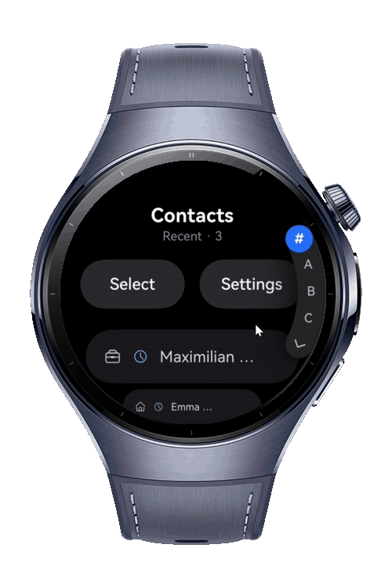
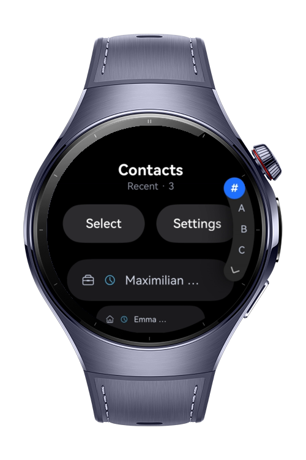
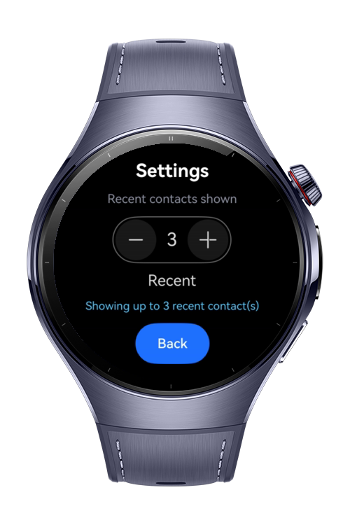
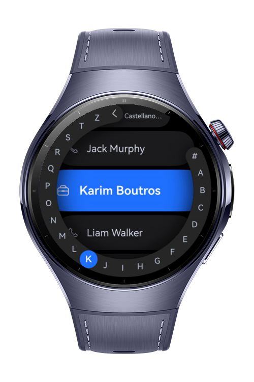

> **Note:** To access all shared projects, get information about environment setup, and view other guides, please visit [Explore-In-HMOS-Wearable Index](https://github.com/Explore-In-HMOS-Wearable/hmos-index).

# How to Build Scroll Filter List

A HarmonyOS NEXT application for browsing and managing contacts on smartwatches. Built with ArkTS and ArkUI, it lets users quickly navigate an alphabetical contact list, jump to recent contacts, select multiple contacts at once, and adjust display preferences all designed for the round watch screen using a mock contact dataset.

# Preview

<div>
  
  
  
  
</div>

# Use Cases

- Browse a contact list optimized for a round smartwatch screen.
- Jump quickly to a letter section using the arc alphabet indexer instead of scrolling the whole list.
- See up to N most-recent contacts at the top of the list (N is configurable in Settings).
- Recognize a contact's type (mobile, work, home) at a glance via inline symbol indicators.
- Read long contact names that don't fit the screen, scrolled automatically when the contact is centered.
- Enter selection mode to select one, several, or all contacts and run a mock batch operation on them.
- Adjust the maximum number of recent contacts shown, with the change reflected immediately in the list.

# Technology

## Stack

* Languages: ArkTS, ArkUI
  Frameworks: HarmonyOS SDK 6.0.1
* Tools: DevEco Studio, Hvigor
* Libraries:
    * `@kit.ArkUI`
        * ArcAlphabetIndexer
        * CheckboxGroup
        * SymbolSpan
        * Marquee
        * advanced.Counter
        * CounterOptions

# Directory Structure

```
entry/src/main/ets/
├─ pages/
│   ├─ NavigationPage.ets
│   ├─ ContactsPage.ets
│   └─ SettingsPage.ets
├─ components/
│   ├─ ContactItem.ets
│   ├─ AlphabetNavigation.ets
│   └─ SettingsCounter.ets
├─ services/
│   └─ NavigationService.ets
├─ provider/
│   └─ MockContactProvider.ets
├─ model/
│   └─ Contact.ets
└─ utils/
    └─ ContactIndex.ets
```

# Constraints and Restrictions

## Supported Devices

* Huawei Watch 5

## Limitations

* ArcAlphabetIndexer, ArcList, and ArcListItem require API version 18 or later.

# License

How to Build Scroll Filter List is distributed under the terms of the MIT License.

See the [LICENSE](LICENSE) file for more information.